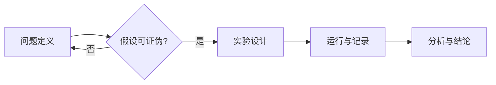
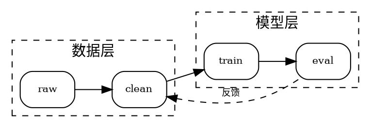

# 示意图与结构图（Diagram Craft）

先选型，再动手。**用错工具的代价不是丑，是画不出来或改不动。**

## 选型决策表

| 你要画的东西 | 用什么 | 产物 | 技能 |
|---|---|---|---|
| 数据关系（曲线、散点、误差棒、分布、热图） | **matplotlib** | PDF/SVG/PNG | → `figure-craft` |
| 方法流程、实验步骤、时序、状态机、ER、甘特 | **Mermaid**（对话内直接渲染） | SVG / 内联图 | 本技能 §1 |
| 依赖图、调用图、网络拓扑、大量节点自动布局 | **Graphviz `dot`** | PDF/SVG/PNG | 本技能 §2 |
| 论文级示意图、坐标变换、电路、几何、与公式混排 | **TikZ**（texlive 已装） | PDF（矢量） | 本技能 §3 |
| 需要人继续拖拽编辑的架构图 | drawio（**未装**，需要时再装插件） | `.drawio` + SVG | — |

判断口诀：**能自动布局就别手摆（Mermaid/Graphviz）；要精确位置就上 TikZ；要给人改就用 drawio。**

## §1 Mermaid —— 流程/时序/状态

在 DSH 里用 ```mermaid 围栏即可**直接渲染成 SVG**（已装 `dsh-mermaid` 0.4.2），支持代码/图形切换、全屏缩放、导出 SVG。



- 常用图型：`graph TD/LR`、`sequenceDiagram`、`stateDiagram-v2`、`classDiagram`、`erDiagram`、`gantt`、`mindmap`。
- 节点文字含特殊字符（括号、冒号、`-->`）时用引号：`A["f(x) = x²"]`。
- 样式克制：`classDef` 只用来区分 2–3 类语义（输入/处理/输出），不要五颜六色。
- **限制**：单图 >50,000 字符或 >2,000 行会被拒绝渲染；布局完全自动，**节点超过 ~20 个就容易交叉线爆炸**。
- 不适合：坐标轴、受力图、电路、分子结构、需要精确对齐的示意图 → 换 TikZ。
- 落盘：源码存 `outputs/figures/<name>.md`（或 `.mmd`），渲染出的 SVG 存同目录，二者一起归档。

## §2 Graphviz —— 关系与网络

自动布局但比 Mermaid 可控（节点样式、rank、cluster、正交边）。`dot`/`neato` 已装。



```bash
dot -Tpdf -Gdpi=300 graph.dot -o graph.pdf
dot -Tsvg graph.dot -o graph.svg
dot -Tpng -Gdpi=200 graph.dot -o graph.png
```

- 大规模/需要计算布局时：`networkx` 建图 → `nx.nx_agraph` 或导出 dot。
- 节点多时用 `rankdir`、`cluster`、`rank=same` 控层次；仍太乱就说明该拆成两张图。
- 字体大小与正文一致（9–10 pt）；`fontname` 指定系统字体，避免换机器变字形。

## §3 TikZ —— 论文级示意图

texlive 里 `tikz` / `pgfplots` / `circuitikz` / `standalone` 都齐。用 `standalone` 类编译，得到**紧裁**的 PDF。

```latex
\documentclass[border=2pt]{standalone}
\usepackage{tikz}
\usetikzlibrary{arrows.meta, positioning, calc}
\begin{document}
\begin{tikzpicture}[>=Stealth, node distance=1.2cm,
    box/.style={draw, rounded corners, minimum width=2.2cm, minimum height=0.8cm, font=\small}]
  \node[box] (src) {Source};
  \node[box, right=of src] (lens) {Lens};
  \node[box, right=of lens] (det) {Detector};
  \draw[->] (src) -- (lens);
  \draw[->] (lens) -- (det);
  \draw[dashed] (det.south) -- ++(0,-0.6) -| node[pos=0.25, below, font=\scriptsize] {$f$} (lens.south);
\end{tikzpicture}
\end{document}
```

```bash
pdflatex -interaction=nonstopmode figure.tex
pdftoppm -png -r 300 figure.pdf figure     # 给对话展示用
```

- 数据图也能用 `pgfplots` 直接从 CSV 画（`\addplot table {data.csv};`），排版比 matplotlib 更贴正文，但迭代慢——**探索阶段用 matplotlib，定稿可换 pgfplots**。
- 电路用 `circuitikz`；几何/向量用 `\usetikzlibrary{calc, angles, quotes}`。
- 字号：图内文字用 `\small`/`\footnotesize`，与正文 10–11 pt 协调，不要出现"图里字比正文大"。

## 统一验收

- [ ] 矢量优先（PDF/SVG）；位图仅用于对话预览（300 dpi）
- [ ] 图内字号与正文同级，缩到单栏宽仍可读
- [ ] 黑白打印可辨（线型/标记/填充纹理区分，不只靠颜色）
- [ ] 每张图有 caption：画什么 / 各元素含义 / 数据或来源 / 生成脚本路径
- [ ] 生成脚本可重跑（`.mmd` / `.dot` / `.tex` / `plot.py` 存 `outputs/figures/<name>/`）
- [ ] `record_save` 归档整个 `outputs/figures/<name>/`（源码 + 产物 + caption）

## 常见坑

- **用 Mermaid 画科学示意图**：自动布局会把"物理位置有含义"的图排错，读者看不出你想表达的结构。
- **节点过多**：>20 个节点还在用 Mermaid，交叉线一定糊；拆图或用 Graphviz cluster。
- **SVG 里文字变路径**：导出时保留字体/文本（TikZ 默认保留），否则后期改不动。
- **字体不一致**：图用 Arial、正文用 Times，投稿会被要求重画。
- **图与正文数字对不上**：图必须由脚本从同一份结果数据生成，不要手改数值。
